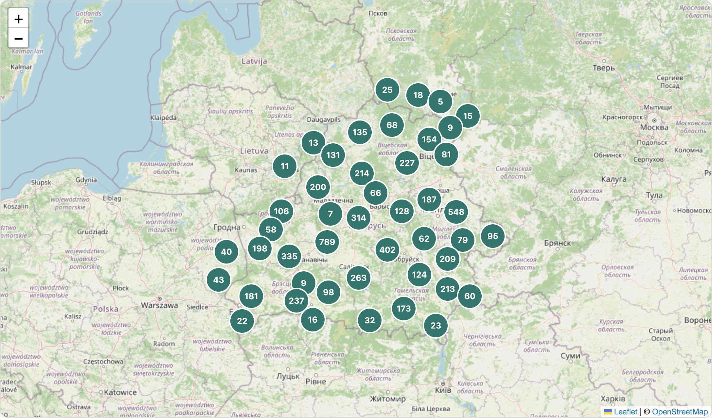
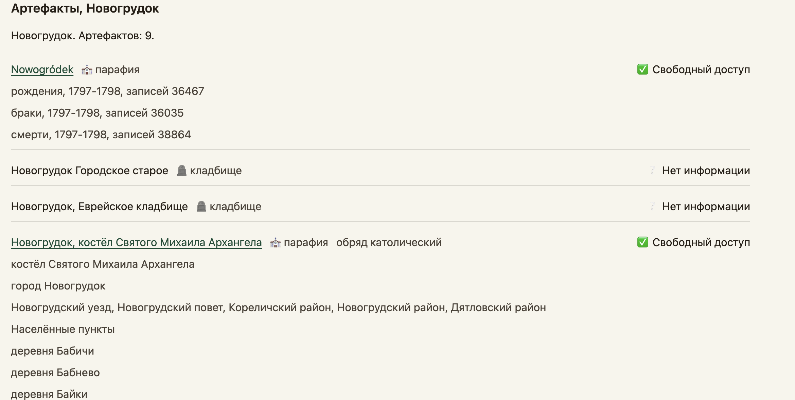
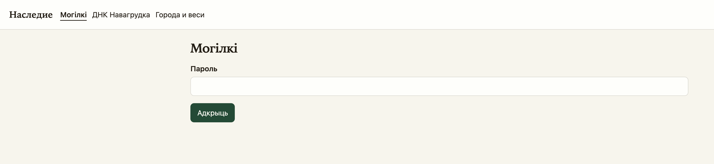

# Наследие

Сайт на FastAPI для генеалогии населённых пунктов Беларуси и соседних мест. На карте «Города и веси» отмечены населённые пункты. У пункта свои артефакты: кладбища и парафии. Отдельный раздел «Могілкі» ищет по спискам захоронений. Ещё есть публичная матрица ДНК Новогрудка и закрытые пространства с деревьями GEDCOM и таблицами совпадений.

Интерфейс по-русски. «Могілкі» — по-белорусски. Страницы отдают заголовок `noindex`.

## Сайт

Живой сайт: [https://62.238.112.84](https://62.238.112.84). Сертификат самоподписанный, браузер один раз предупредит.

- [Города и веси](https://62.238.112.84/vesi) — карта населённых пунктов
- [Могілкі](https://62.238.112.84/mogilki) — общий пароль, не учётная запись сайта
- [Вход](https://62.238.112.84/login)
- [Регистрация](https://62.238.112.84/register)



Карта населённых пунктов, подложка OpenStreetMap.



Новогрудок на той же карте: парафии и кладбища одного пункта.



«Могілкі» открывается с пароля.

## Страницы

| Адрес | Кто открывает | Что там |
| --- | --- | --- |
| `/` | все | Ссылки на три основных раздела |
| `/vesi` | все | Карта населённых пунктов |
| `/vesi/{id}` | все | Карточка кладбища или парафии |
| `/mogilki` | общий пароль | Поиск по спискам захоронений |
| `/novogrudok` | все | Матрица наборов ДНК Новогрудка |
| `/register`, `/login` | гости | Учётная запись сайта |
| `/admin` | администратор | Пользователи и пространства |
| `/s/{id}/…` | участник пространства | Деревья, ДНК, кластеры, связи |
| `/health` | все | `{"ok": true}` |

Меню на страницах: «Могілкі», «ДНК Навагрудка», «Города и веси», «Регистрация». Пространства в это меню не входят.

### Города и веси

`/vesi` — карта населённых пунктов, не пины кладбищ. Подложка OpenStreetMap. Населённый пункт можно найти по названию или выбрать на карте.

Артефакты пункта:

- кладбище со списком захоронений или только с меткой на карте;
- парафия Geneteka;
- парафия каталога [prikhody](https://shappoff.github.io/prikhody/).

У артефакта один из двух статусов:

- **Свободный доступ** — по кладбищу есть проиндексированный список, у парафии Geneteka есть индекс, у парафии prikhody есть документы или страница источника;
- **Нет информации** — такого источника нет.

Цвет метки пункта считается по доле артефактов, у которых статус не «Нет информации»:

- красный, «нет сведений» — таких артефактов нет;
- жёлтый, «мало сведений» — их меньше 25%;
- зелёный, «есть сведения» — 25% и больше.

Координаты метки — координаты населённого пункта. Границы городов в `maps/cemeteries/cities.json` собирают артефакты внутри города на одну метку. В файле 16 городов, название берётся русское (Гродно, а не Гродна с границы).

Кладбище со статусом «Свободный доступ» открывает `/vesi/{id}`: список фамилий и ссылку `/mogilki?cemetery=НАЗВАНИЕ`. Кладбище без списка фамилий на «Могілкі» не ведёт. Именные строки Geneteka сайт не хранит: у парафии остаются годы, число записей и ссылка на индекс.

Проиндексировано 23 кладбища (и тесты это проверяют). Списки лежат в `maps/cemeteries/burials.json`: 23 кладбища и 17843 записи.

Авдеевичи, Бенин Православное, Большие Воробьевичи, Валевка, Вселюб Католическое, Вселюб Православное, Кошелево, Ладеники Православное, Любча 1Мая, Любча Ленина, Мотча Православное, Невда, Негневичи Новое, Негневичи Старое, Осташино, Попковичи, Сунчицы, Щорсы, Новосады, Юшковичи, Делятичи, Черешля, Демьяновка.

Каталог Geneteka — `maps/cemeteries/geneteka_parishes.json`: регион Białoruś (`22br`), 364 парафии. К населённому пункту крепится только запись со статусом `verified` и одним уже существующим id пункта. В файле 161 verified, 86 ambiguous, 101 not_on_map, 16 cemetery_only.

Каталог prikhody — `maps/cemeteries/prikhody_parishes.json`: 2988 парафий, 110594 документов, у 2782 есть координаты. Документ показывает год, тип (рождения, браки, умершие), архив, фонд (поле ФОД), ссылку на снимки, пометки «оцифровано» и «отказано в выдаче». Парафия присоединяется к ближайшему пункту, если имя сходится в пределах 15 км или точка ближе 4 км. Точка внутри границы города присоединяется к этому городу. Иначе на координатах каталога появляется новый населённый пункт.

Артефакт без населённого пункта остаётся в списке «Без населённого пункта». Привязка пишется в таблицу `artifact_settlements`. Те же пары читаются из `maps/cemeteries/artifact_settlements.json` (284 строки) и добавляются при старте, если в базе их ещё нет. Форму привязки видит только учётная запись, имя которой задано в `app/routes/vesi.py`.

### Могілкі

`/mogilki` — отдельный вход. Это общий пароль из переменной `MOGILKI_PASSWORD`, а не учётная запись сайта. После входа сессия помечается флагом `mogilki`. Выход — `POST /mogilki/logout`.

Открытый раздел ищет по могілках, прозвішчы и году на русском. Фильтр `?cemetery=` сохраняется на форме пароля, поэтому ссылка с карточки кладбища доходит до поиска. Данные: `maps/cemeteries/burials.json` и карта `maps/cemeteries/data.js`. Карта собирается из KML и слоя «Праіндэксаваныя могілкі».

### ДНК Навагрудка

`/novogrudok` открыт без входа. Это матрица сохранённых совпадений GEDmatch: поколение или общие cM, кластеры, ссылка на пару `/novogrudok/{kit}/{kit}`. Список наборов читается из таблицы, запасной снимок — `app/novogrudok_kits.txt`. Правка родства на паре доступна одной учётной записи.

### Учётные записи и пространства

Пароли пользователей хранятся через argon2. Сессия — cookie `heritage_session` на 14 дней. Регистрация создаёт обычного пользователя. Первый администратор появляется только в пустой базе из `HERITAGE_ADMIN_USER` и `HERITAGE_ADMIN_PASSWORD` (пароль от 8 символов). Дальше пользователями и пространствами занимается `/admin`.

Пространство (`/s/{id}/…`) доступно его участникам. Там загрузка GEDCOM, таблицы ДНК, кластеры AutoClusters и GEDmatch, связи между деревьями и импорт Geneteka. Эти адреса без сессии уводят на `/login`.

## Данные

Каталог `maps/cemeteries/`:

| Файл | Содержание |
| --- | --- |
| `data.js` | Точки и слои карты могілак |
| `burials.json` | Списки захоронений |
| `geneteka_parishes.json` | Парафии Geneteka |
| `prikhody_parishes.json` | Парафии и документы prikhody |
| `artifact_settlements.json` | Готовые привязки артефактов к пунктам |
| `cities.json` | Границы городов |
| `navahrudak-uyezd.json` | Контур Новогрудского уезда |
| `build_data.py` | Сборка `data.js` из KML |
| `build_burials.py` | Сборка `burials.json` из PDF или CSV |

База приложения — SQLite `heritage.db` в каталоге `HERITAGE_DATA_DIR` (локально `data/`). Туда же пишутся загрузки. Каталог `data/` и файл `.env` в репозиторий не кладутся.

Скрипты подготовки, они не запускают сайт:

- `scripts/build_prikhody.py` — из выгрузки prikhody пишет `prikhody_parishes.json`. Нужны `--main`, `--firebase` и `--out`. Приложение само при старте раскладывает парафии по пунктам.
- `scripts/build_v1ras.py` — правит ячейки листа В1рас по справочнику, выпуску и глоссарию. Сокращение губернии, уезда или волости раскрывается только при одном совпадении.
- `scripts/build_nvg.py` — собирает сетку Новогрудского уезда из CSV В1рас и В2рас.

## Локально

Нужен Python 3.12, как в `Dockerfile`.

```bash
python3 -m venv .venv
source .venv/bin/activate
pip install -r requirements-dev.txt
cp .env.example .env
```

В `.env` задайте свои значения:

- `HERITAGE_SECRET` — длинная случайная строка. В production не короче 16 символов. Локально подойдёт `openssl rand -hex 24`.
- `HERITAGE_ADMIN_USER` и `HERITAGE_ADMIN_PASSWORD` — первый администратор, пароль от 8 символов. В уже заполненную базу они не записываются.
- `HERITAGE_COOKIE_SECURE=0` на `http://127.0.0.1`.
- `MOGILKI_PASSWORD` — пароль раздела «Могілкі».

```bash
uvicorn app.main:app --reload
```

Откройте http://127.0.0.1:8000 . «Города и веси» и «ДНК Навагрудка» открываются сразу. «Могілкі» спрашивает общий пароль.

Проверка:

```bash
pytest
```

`pytest.ini` берёт каталог `tests` и добавляет корень проекта в `pythonpath`.

## Сервер

Нужны Docker и Docker Compose. В `.env` на сервере те же секреты, плюс `HERITAGE_PUBLIC_IP` — IPv4, он попадает в самоподписанный сертификат. Let's Encrypt на голый IP не выпускается: браузер один раз предупредит о сертификате.

```bash
docker compose up -d --build
```

Caddy слушает 80 и 443 и перенаправляет HTTP на HTTPS. Приложение слушает 8000 только внутри сети Compose. Образ ставит `requirements.txt`, копирует `app/` и `maps/`, запускает `uvicorn app.main:app`. База и загрузки лежат в томе `heritage-data`, сертификаты — в `heritage-certs`. Смена IP: поправьте `HERITAGE_PUBLIC_IP` и снова выполните `docker compose up -d`. Том с базой при этом остаётся.
